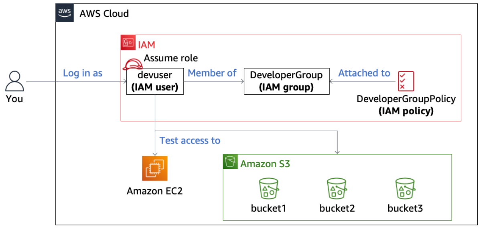

# AWS S3 and IAM access-control lab

I used a preconfigured AWS training environment to compare access as `devuser`, `BucketsAccessRole`, and `OtherBucketAccessRole`. The lab examines identity policies, role assumption, S3 bucket policies, and the difference between bucket-level and object-level permissions.

[Full detailed report](report.pdf) · [All 38 original images](assets/)

## Lab architecture

Original architecture diagram from the lab notes.

## Work covered

- Explored EC2, S3 and IAM access as `devuser`.
- Inspected `DeveloperGroupPolicy` and compared bucket creation with object upload.
- Recorded denied object reads and uploads.
- Assumed `BucketsAccessRole`, downloaded `Image2.jpg` from bucket1, and compared IAM group visibility before and after switching roles.
- Inspected role permissions, the trust relationship and the bucket2 resource policy.
- Investigated the bucket3 policy principal and recorded a successful upload under `OtherBucketAccessRole`.

## Results

| Test | Recorded result |
| --- | --- |
| `devuser`: create a bucket | Allowed |
| `devuser`: upload an object | Denied |
| `devuser`: read a bucket1 object | Denied |
| `BucketsAccessRole`: download from bucket1 | Allowed |
| `BucketsAccessRole`: list IAM groups | Denied |
| `BucketsAccessRole`: upload to bucket2 | Allowed |
| `OtherBucketAccessRole`: upload to bucket3 | One file succeeded |

The key finding was that the role identity policy alone did not describe every access path. The bucket2 policy supplied a resource-based permission path. The bucket3 policy named another role, matching the active principal in the later successful upload capture.

## Documentation

The expanded report provides the environment, method, step-by-step observations, policy explanations, failures, challenge outcome, lessons, references and a complete image index. All 38 source images are included with their original filenames and bytes, without editing or redaction.

The captures span several training sessions. The report distinguishes observed results from supplied instructions, example command output and explanatory diagrams. The training environment supplied the initial identities, policies, roles and buckets. A complete second-role policy audit, CloudTrail trace and final grading result are not claimed.

References: [S3 API permissions](https://docs.aws.amazon.com/AmazonS3/latest/userguide/using-with-s3-policy-actions.html), [STS AssumeRole](https://docs.aws.amazon.com/STS/latest/APIReference/API_AssumeRole.html), and [IAM policy evaluation](https://docs.aws.amazon.com/IAM/latest/UserGuide/reference_policies_evaluation-logic.html).
